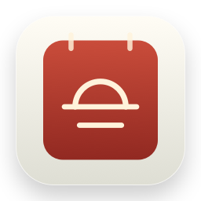
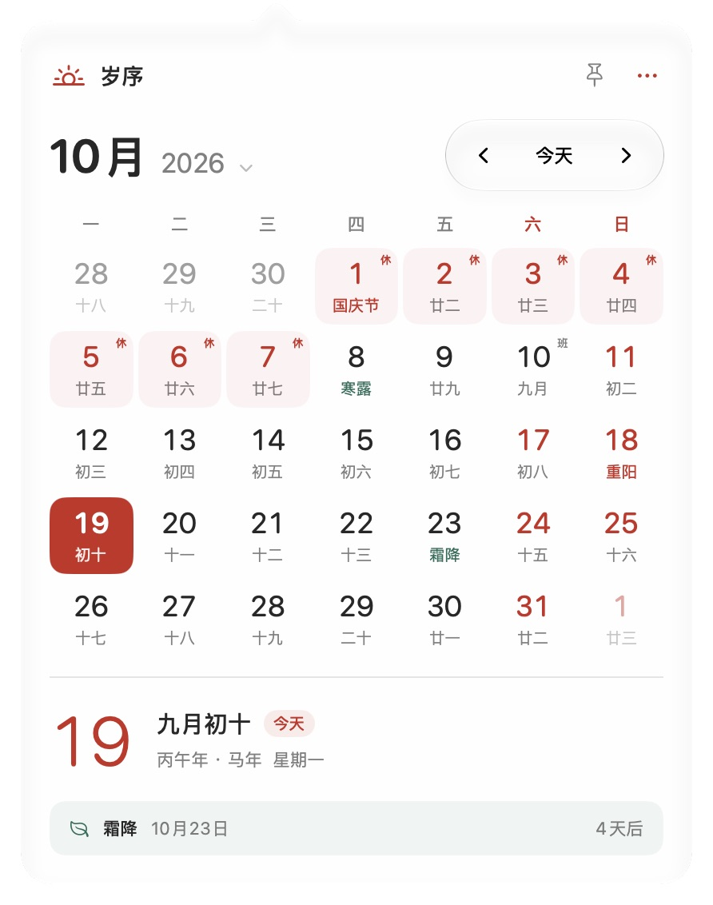
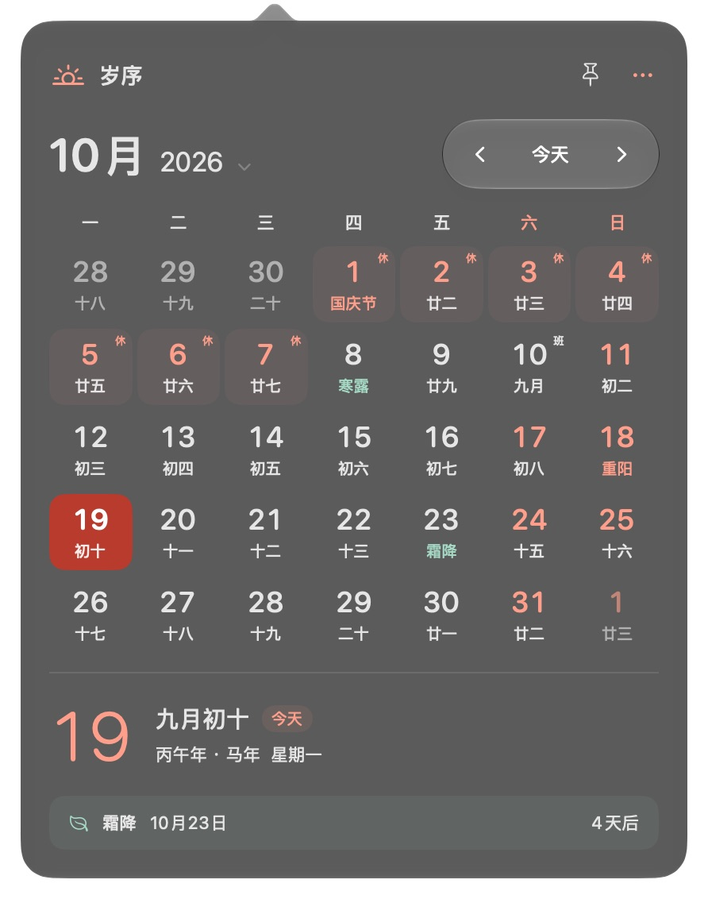

<div align="center">
  
  <h1>岁序 · SuiXu</h1>
  <p>日有序，岁有时。一个原生、轻量的 macOS 中国历法菜单栏应用。</p>
  <p><strong>简体中文</strong> · <a href="README.en.md">English</a></p>
  <p>
    <a href="https://github.com/microstudent/SuiXu/actions/workflows/ci.yml"></a>
    
    
    <a href="LICENSE"></a>
  </p>
</div>

岁序把公历、农历、节气和中国大陆放假调休放在一个紧凑的弹出面板里。使用 SwiftUI + AppKit，无第三方运行时依赖，无广告、账户或行为追踪。**应用界面目前为简体中文；项目文档提供中英双语。**

<p align="center">
  
  
</p>

## 功能

- **中国历法**：1901–2100 年公历、农历、干支生肖、常用传统节日及离线二十四节气。
- **放假与补班**：内置 2025、2026 年中国大陆官方安排，分别标识「休」与「班」，支持年度清单。未收录年份明确提示，不猜测调休。
- **紧凑月历**：五／六行自动布局、年月跳转、键盘导航、回到今天、图钉固定浮层。
- **菜单栏日期**：日期与星期、简短日期或农历，可附带 24 小时时间。
- **原生外观**：跟随系统／浅色／深色，导航使用 Liquid Glass，日期面板保留原生磨砂；支持减少透明度和增强对比度。
- **安静运行**：日常只显示菜单栏入口；打开设置时显示 Dock 图标，关闭设置后隐藏。支持登录时启动。
- **可选天气**：默认关闭，手动选择 12 个常用城市，无需定位权限；通过 Open-Meteo 按需获取，缓存 30 分钟。

## 环境要求

| 项目 | 要求 |
| --- | --- |
| 运行系统 | macOS 26.0 或更新版本 |
| 构建工具 | 完整 Xcode 26 或更新版本；仅 Command Line Tools 不够 |
| 架构 | Apple Silicon（arm64）已验证；默认构建当前主机架构，Intel 尚未验证 |
| 网络 | 日历离线可用；启用天气或手动刷新数据源时需要联网 |

## 安装与运行

目前推荐从源码构建。只有 [Releases](https://github.com/microstudent/SuiXu/releases) 中实际发布的资产才是可下载版本；仓库不包含预编译 `.app`。

```sh
git clone https://github.com/microstudent/SuiXu.git
cd SuiXu
./scripts/build.sh
open dist/岁序.app
```

将 `dist/岁序.app` 拖入「应用程序」，退出构建目录中的旧实例，再从「应用程序」启动。此后可用 Spotlight 或「应用程序」找到岁序。更新时先退出旧版本，再替换应用。

本地构建默认使用 **ad-hoc 签名**，尚无 Developer ID 签名或 Apple 公证。构建成功不代表具备面向其他 Mac 的公证分发能力；发布要求见 [发布指南](docs/RELEASING.md)。

## 使用

点击菜单栏日期展开日历；右键打开快捷菜单。点击日期查看详情，点击月份标题跳转年月。右上角「…」提供年度节假日、设置和退出入口。

| 快捷键 | 操作 |
| --- | --- |
| 空格 | 回到今天 |
| ← / →，↑ / ↓ | 前后一天、前后一周 |
| ⌘← / ⌘→ | 上个月／下个月 |
| ⌘, | 打开设置 |
| Esc | 关闭浮层或当前面板 |
| ⌘W | 关闭设置窗口 |
| ⌘Q | 退出岁序 |

日期导航快捷键在日历浮层打开且未进入年月选择／年度清单时生效。菜单栏位置由 macOS 管理，可按住 ⌘ 拖动调整；应用不强制抢占最右侧。

## 数据与隐私

- 中国历法统一使用 **UTC+8**，不随旅行或系统时区变化。
- 农历转换由 Foundation 提供；4,800 条节气日期整理自香港天文台，日常使用无需下载。
- 放假调休来自国务院办公厅通知，目前仅覆盖 **2025、2026 年**，需随应用版本更新。
- 天气关闭时应用不发起天气请求。启用后向 Open-Meteo 发送所选城市的公共坐标；服务端也会接收到连接所需的 IP 地址。应用不请求精确定位、不上传日历选择记录，不集成分析 SDK。
- 天气为模型估算值；远期历法可能受权威资料修订影响。来源、维护方法与范围见 [数据说明](docs/DATA.md)。

## 开发与验证

```sh
swift test                    # 历法、数据与应用状态测试
./scripts/build.sh debug       # Debug 应用
./scripts/build.sh             # Release 应用 + 签名校验
./scripts/package.sh           # 版本化 ZIP + SHA-256 校验文件
```

也可以用 Xcode 打开 `Package.swift`。打包脚本包含资源和应用图标，使用标准 `.app` 验证菜单栏与登录启动行为。Debug 版的 `⌘⇧D` 只切换应用自己的临时外观，Release 不包含该快捷键。

CI 在 push 和 pull request 时运行测试与 Release 打包；GitHub Actions 使用固定提交版本并由 Dependabot 检查更新。测试覆盖 200 年的月份边界、两种周起始布局、春节换年、闰月、UTC+8 零点、节气和官方调休。实机验证范围及未验证项见 [验证记录](docs/VALIDATION.md)。

```text
Sources/Suixu/          SwiftUI / AppKit 应用、设置、天气
Sources/SuixuCore/      历法逻辑与离线数据
Tests/                 Swift Testing 测试
Resources/             应用元数据与原创图标
scripts/               构建、打包、图标及数据维护
.github/               CI、发布工作流与协作模板
docs/                  数据来源、发布说明与实机截图
```

## 参与贡献

欢迎用中文或英文提交 [Issue](https://github.com/microstudent/SuiXu/issues) 和 PR。开始前请阅读 [贡献指南](CONTRIBUTING.md)。安全问题请按 [安全政策](SECURITY.md) 私下报告。版本变更记录见 [CHANGELOG](CHANGELOG.md)。

## 许可证与致谢

原创源码、文档及应用图标采用 [MIT](LICENSE)，版权归 leavesgeek 及相应贡献者所有。**第三方数据与服务不因此重新授权为 MIT**：天文台资料和 Open-Meteo 分别受其来源条款约束，商用分发前请核对；具体见 [第三方声明](THIRD_PARTY_NOTICES.md)。

感谢香港天文台、国务院办公厅公开的历法与假期信息，以及 Open-Meteo 的天气服务。岁序是独立项目，与上述机构及 Apple 均无隶属或认可关系。
